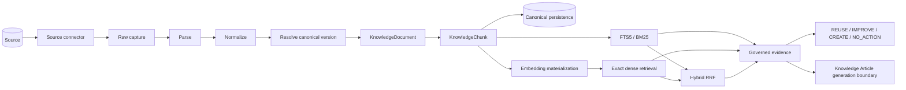

# Tropos

**Every resolution strengthens the next.**

[](https://github.com/kumarchandansingh/tropos/actions/workflows/ci.yml)

Tropos is a governed knowledge-management system for turning resolved support cases into auditable knowledge decisions and evidence-backed operational knowledge. The repository is organized as a reusable governed-knowledge core plus domain capabilities such as **Tropos Resolve**.

Tropos Resolve produces one of four knowledge actions:

| Action | Meaning |
| --- | --- |
| `REUSE` | Existing knowledge is sufficient. |
| `IMPROVE` | Related knowledge exists but is incomplete. |
| `CREATE` | No adequate knowledge exists. |
| `NO_ACTION` | Closure evidence is insufficient to justify a knowledge change. |

## Current status

Tropos currently provides a local, testable implementation baseline. Ingestion, governed retrieval, hybrid ranking, evidence-backed generation contracts, and evaluation controls exist in the repository. A hosted API/MCP product surface and production generative-model runtime are not yet implemented.

| Area | Status |
| --- | --- |
| Source-connector contract and local-file source adapter | Implemented |
| Raw capture and deterministic parsing for text, Markdown, HTML, and DOCX | Implemented |
| Access policy, normalization, canonical versioning, and lifecycle | Implemented |
| Deterministic chunking and evidence lineage | Implemented |
| Synchronous ingestion orchestration and SQLite persistence | Implemented |
| Resolve decision policy and orchestration | Implemented |
| SQLite FTS5/BM25 lexical retrieval | Implemented |
| Versioned embedding materialization and exact cosine dense retrieval | Implemented baseline |
| BM25 + dense Reciprocal Rank Fusion (RRF) hybrid retrieval | Implemented baseline |
| Retrieval evaluation, regression gate, and real embedding-model workflow | Implemented baseline |
| Knowledge Article contracts and LangChain-compatible generator adapter | Implemented baseline; production provider wiring pending |
| External enterprise source connectors; PDF/OCR and richer parsing | Planned |
| Hosted HTTP/MCP delivery surface | Planned |
| Production generative-model wiring and real-model Knowledge Article evaluation | Planned |
| Retrieval abstention calibration and product-outcome evaluation | Planned |

## Architecture



Authorization, lifecycle, and canonical identity remain outside model inference. Retrieval strategies implement the same application contract, so lexical, dense, and hybrid search can evolve without changing domain consumers.

The codebase follows a modular-monolith and Ports-and-Adapters design. Reusable source integration, evidence, access, parsing, normalization, versioning, chunking, embeddings, retrieval, and persistence live in `tropos.core`; support-case-specific policy lives in `tropos.capabilities.resolve`.

See the [architecture overview](docs/architecture/ARCHITECTURE_OVERVIEW.md) for module boundaries and dependency rules and the [RAG architecture](docs/architecture/RAG_ARCHITECTURE.md) for retrieval details.

## Quality and evaluation

Tropos separates deterministic correctness, zero-tolerance invariants, retrieval benchmarks, real-model evaluations, and future product-outcome measurement.

Current controls include:

- unit, integration, and shared retriever contract tests;
- authorization, current-version, evidence-integrity, and result-contract invariants;
- baseline-versus-candidate retrieval regression gating in pull requests;
- a separate real embedding-model workflow for BM25, dense, and hybrid retrieval;
- deterministic Knowledge Article grader validation.

The current retrieval datasets are small and synthetic. Their results establish engineering evidence for this repository; they are not production accuracy claims.

See the [evaluation product model](docs/architecture/EVALUATION_MODEL.md), [evaluation strategy](docs/quality/EVAL_STRATEGY.md), and [saved evaluation guide](docs/architecture/EVALUATION_RUNS.md).

## Repository

```text
.
├── apps/api/
│   ├── src/tropos/core/
│   ├── src/tropos/capabilities/resolve/
│   ├── src/tropos/evals/
│   └── tests/
├── docs/
├── scripts/
└── .github/
```

## Development

The API package requires Python 3.14 and uses `uv`, Ruff, mypy, and pytest.

```bash
cd apps/api
uv sync --dev --locked
uv run ruff format --check .
uv run ruff check .
uv run mypy src tests
uv run pytest
uv build
```

GitHub Actions runs the same application checks and also audits public documentation impact for material pull-request changes.

## Documentation

Start with [docs/README.md](docs/README.md).

Key public records:

- [Product model](docs/product/PRODUCT_MODEL.md)
- [Architecture overview](docs/architecture/ARCHITECTURE_OVERVIEW.md)
- [RAG architecture](docs/architecture/RAG_ARCHITECTURE.md)
- [Evaluation product model](docs/architecture/EVALUATION_MODEL.md)
- [Evaluation strategy](docs/quality/EVAL_STRATEGY.md)
- [Architecture decisions](docs/decisions/README.md)
- [Delivery governance](docs/product/delivery-governance.md)
- [Public documentation standard](docs/standards/PUBLIC_DOCUMENTATION_STANDARD.md)

## Repository data boundary

Examples and fixtures in this repository are synthetic. Secrets, real customer or support records, confidential employer/client material, production configuration, and personal career material do not belong in the repository.
