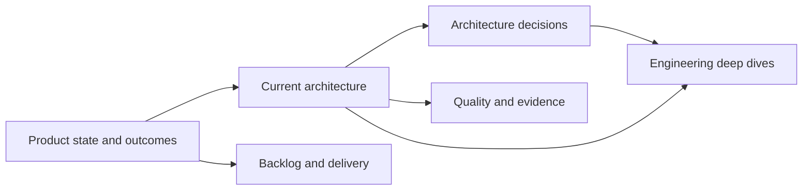

# Tropos documentation

## Purpose

Tropos documentation is organized by the question a stakeholder needs answered. Product, architecture, decisions, quality evidence, and delivery controls have separate canonical owners so that implementation status, design rationale, and future work do not drift into one another.

The [public documentation standard](standards/PUBLIC_DOCUMENTATION_STANDARD.md) defines the writing, evidence, and change-control rules for this repository.

## Start here

| Question | Canonical document |
| --- | --- |
| What is Tropos as a product? | [Tropos platform](product/TROPOS_PLATFORM.md) |
| What does Resolve do? | [Resolve](product/RESOLVE.md) |
| What does Training do? | [Training](product/TRAINING.md) |
| What has already been built? | [Build history](product/BUILD_HISTORY.md) |
| What is the current technical architecture? | [Architecture overview](architecture/ARCHITECTURE_OVERVIEW.md) |
| Why were durable design choices made? | [Architecture decisions](decisions/README.md) |
| How do product quality and the evaluation runtime fit together? | [Evaluation product model](architecture/EVALUATION_MODEL.md) |
| How is quality evaluated? | [Evaluation strategy](quality/EVAL_STRATEGY.md) |
| What is planned next? | [Master backlog](product/master-backlog.md) |
| How is delivery governed? | [Delivery governance](product/delivery-governance.md) |
| Where are delivery metrics defined? | [Delivery metrics](product/delivery-metrics.md) |
| What standard governs public documentation? | [Public documentation standard](standards/PUBLIC_DOCUMENTATION_STANDARD.md) |

## Documentation model

### Product

Product documents define the user problem, capability boundary, current maturity, product principles, and roadmap.

- [Product entry point](product/PRODUCT_MODEL.md)
- [Tropos platform](product/TROPOS_PLATFORM.md)
- [Resolve](product/RESOLVE.md)
- [Training](product/TRAINING.md)
- [Build history](product/BUILD_HISTORY.md)
- [Master backlog](product/master-backlog.md)

### Architecture

Architecture documents describe the system as it exists now. They do not present implemented capability as future work.

- [Architecture overview](architecture/ARCHITECTURE_OVERVIEW.md)
- [Codebase map](architecture/CODEBASE_MAP.md)
- [Source integration](architecture/SOURCE_INTEGRATION.md)
- [Connector reliability](architecture/CONNECTOR_RELIABILITY.md)
- [Ingestion and normalization](architecture/INGESTION_NORMALIZATION.md)
- [Knowledge model](architecture/KNOWLEDGE_MODEL.md)
- [RAG architecture](architecture/RAG_ARCHITECTURE.md)
- [Knowledge Article architecture](architecture/KNOWLEDGE_ARTICLE.md)
- [Evaluation product model](architecture/EVALUATION_MODEL.md)
- [Evaluation contracts](architecture/EVALUATION_CONTRACTS.md)
- [Evaluation experiments](architecture/EVALUATION_EXPERIMENTS.md)
- [Evaluation runs](architecture/EVALUATION_RUNS.md)

### Architecture decisions

[Architecture Decision Records](decisions/README.md) preserve durable choices, credible alternatives, consequences, evidence, and revisit triggers. Accepted records remain part of the history when later decisions supersede them.

### Quality and delivery

- [Evaluation strategy](quality/EVAL_STRATEGY.md)
- [Enterprise support retrieval evidence](quality/ENTERPRISE_SUPPORT_RETRIEVAL_EVIDENCE.md)
- [Retrieval abstention calibration](quality/RETRIEVAL_ABSTENTION.md)
- [Evidence sufficiency benchmark V1](quality/EVIDENCE_SUFFICIENCY.md)
- [Enterprise support benchmark](quality/ENTERPRISE_SUPPORT_BENCHMARK.md)
- [CI/CD](delivery/CI_CD.md)
- [Environment strategy](delivery/ENVIRONMENT_STRATEGY.md)
- [Delivery governance](product/delivery-governance.md)
- [Delivery metrics](product/delivery-metrics.md)

### Engineering deep dives

[Engineering deep dives](learning/README.md) explain selected mechanisms and cross-cutting trade-offs in more detail than living architecture should carry. They are public technical material but are not authoritative for implementation status.

- [Engineering capability & solution map](learning/ENGINEERING_CAPABILITY_SOLUTION_MAP.html)

## Status vocabulary

| Status | Meaning |
| --- | --- |
| **Implemented** | Executable behavior exists in the repository |
| **Implemented baseline / V1** | Executable but deliberately bounded; not production-complete |
| **Contract only** | Stable interface/domain contract exists without the concrete production adapter |
| **Evaluated** | The named subject was executed against the stated dataset or test |
| **Planned** | Prioritized or intended work with no executable implementation |
| **Deferred** | Intentionally postponed until an explicit trigger or evidence justifies it |

## Source-of-truth hierarchy

When documents disagree, reconcile them using this order:

1. executable code and tests establish what behavior exists;
2. living architecture describes the intended current technical state;
3. Architecture Decision Records explain why durable choices were made;
4. product documents describe capability and product state;
5. quality evidence supports or limits measured claims;
6. backlog and issues describe future work;
7. engineering deep dives explain mechanisms but do not override current-state sources.

Stale documentation is a defect.

## Documentation completeness rule

A material build should leave behind the public record required by the [documentation standard](standards/PUBLIC_DOCUMENTATION_STANDARD.md):

- current product/capability status when it changes;
- current architecture/runtime state when it changes;
- the decision, credible alternatives, consequences, evidence, and revisit trigger for durable choices;
- quality/evaluation evidence when a claim changes;
- delivery/backlog state when sequencing changes.

Pull requests must update the appropriate public source of truth or explicitly justify why documentation impact is N/A. CI audits that requirement.

## Glossary and diagrams

- [Technical glossary](GLOSSARY.md)
- [Archify diagrams](diagrams/archify/README.md)

## Repository boundary

Examples and fixtures are synthetic. Secrets, real customer/support records, confidential employer/client material, production credentials, and personal career material do not belong in the public repository.
