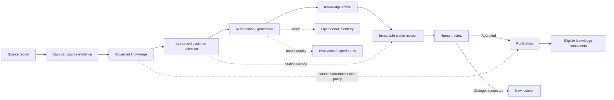
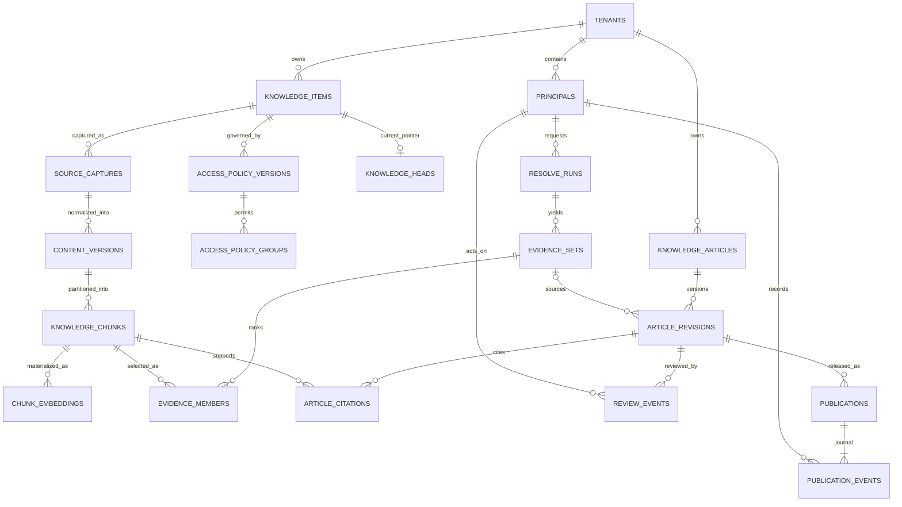
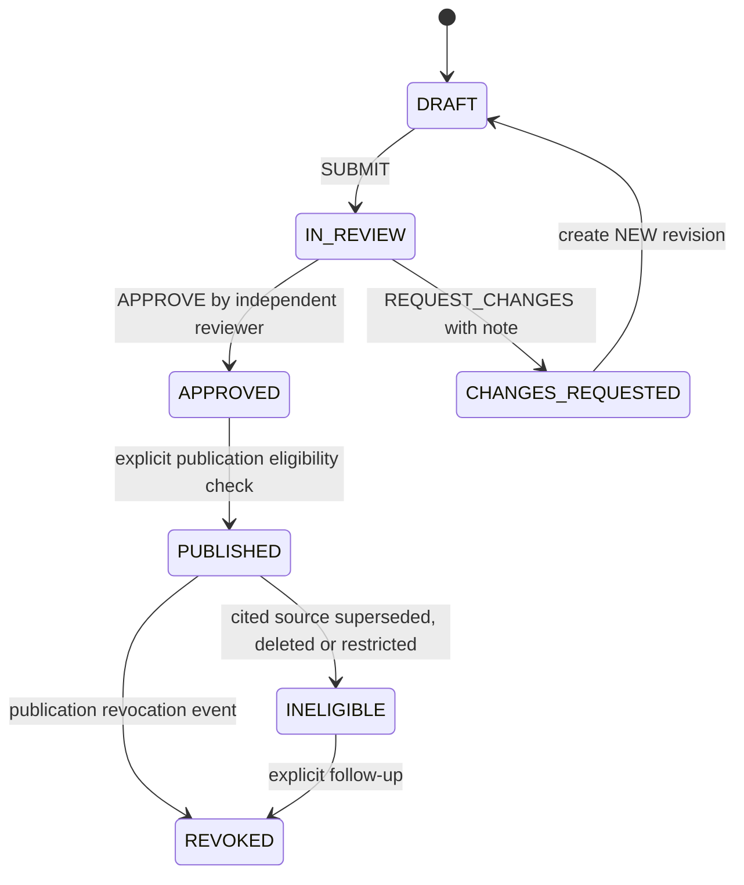

# Tropos end-to-end data model — conceptual, logical and physical V1

**Status:** Target/reference design; not a deployed database migration.
**Checked against:** `main` at `cdb9df42` (2026-10-25) and draft [GOV-101A PR #117](https://github.com/kumarchandansingh/tropos/pull/117) (2026-11-10).
**Target scope:** source intake → canonicalization → retrieval/evidence → generated Knowledge Article → revision/review → governed publication → audit/evaluation.
**Runnable contract:** [target_schema.sql](data-model/target_schema.sql), exercised by `apps/api/tests/unit/core/test_target_data_model_contract.py`.

This is a *modeling deliverable*, not a claim that every component already runs. Its purpose is to settle identities, cardinalities, ownership, normalization, controls and migrations **before** adding a production article-approval UI. No customer data or secrets are included.

## 1. Business requirements and the grain of each record

**Decision questions the model must answer:**

1. Which source record produced an answer or Knowledge Article claim, and which exact captured bytes, canonical version, chunk and content hash support it?
2. Which tenant and access policy governed that evidence *when it was retrieved* and what policy applies *now*?
3. What did the model generate, what did the human approve, and what was later published?
4. Did anyone edit content after approval? Which reviewer acted, and in what order?
5. Can an article still be served after a source is replaced, restricted, or deleted?
6. Which retrieval/model/evaluation version and runtime trace explain a failure?

**Five categories of data — never conflate them:**

| Category | System of record | Examples | Mutation policy |
| --- | --- | --- | --- |
| Source evidence | Immutable capture ledger | Source ID, raw payload, ingestion fingerprint | Append capture |
| Canonical knowledge | Versioned source of truth + current pointers | Knowledge identity, canonical document versions, chunks, policies | Append versions; update pointers |
| Derived/search state | Recomputable materialization | FTS5 postings, embeddings, fused ranks | Rebuild by strategy/version |
| Product decisions | Immutable revisions + event history | Evidence set, article revision, review decision, publication | Append events; update controlled projections |
| Diagnostics/evaluation | Separate evidence of behavior | Traces, EvalDataset, EvalRun, EvalObservation | Append records, preserve provenance |

**The immutable unit is not always the same as the identity:** `knowledge_id` identifies a source-backed *logical knowledge record*; `(knowledge_id, content_fingerprint, normalization_strategy_version)` identifies its canonical content version; `chunk_id` identifies a particular content occurrence; `article_id` identifies a logical output; `(article_id, revision_no)` identifies the exact reviewed output.

## 2. Existing state — evidence from executable repository

| Current storage/model | Actual implementation | Classification | Delta versus target |
| --- | --- | --- | --- |
| `source_captures` | `core/adapters/persistence/sqlite.py` | Implemented | Source capture table exists; target adds explicit composite tenant relationships |
| `ingestion_runs` | `core/adapters/persistence/sqlite.py` | Implemented | Preserve idempotent processing/run status; target modeling isolates processing history |
| `knowledge_state` | `core/adapters/persistence/sqlite.py` | Implemented | Current content fingerprint, normalizer, access fingerprint and tombstone; target separates content/policy history and current head |
| `knowledge_versions` | `core/adapters/persistence/sqlite.py` | Implemented | Canonical version PK `(knowledge_id, content_fingerprint, normalization_strategy_version)` |
| `knowledge_chunks` | `core/adapters/persistence/sqlite.py` | Implemented | Text, offsets, content/source lineage and copied access policy; target adds composite FKs and distinct policy history |
| `knowledge_chunks_fts` | `core/adapters/retrieval/sqlite_fts.py` | Implemented FTS5 | Derived lexical index, with triggers; not canonical |
| `knowledge_embeddings` | `core/adapters/embeddings/sqlite.py` | Implemented | Keyed by `(chunk_id, embedding_strategy_version)`; derived vector data |
| `EvidenceSet`, `EvidenceItem`, `ResolveResult` | `capabilities/resolve/domain` | Typed runtime objects | No canonical durable relational evidence-set store |
| `KnowledgeArticleDraft` | `core/domain/knowledge_article.py` | Typed generation artifact | No merged persistent revision/publication model |
| `article_reviews`, `article_review_events` | Draft PR #117 | **Proposed in unmerged PR**, not main | Local immutable draft snapshot and one terminal human decision; no tenant/revision/publish contract yet |
| `eval_datasets`, `eval_cases`, `eval_runs`, `eval_executions`, `eval_hits`, `eval_assertions`, `eval_metrics` | `evals/run_store.py` | Implemented evaluation store | Keep separate from business database |
| `experiment_runs`, `experiment_observations`, `experiment_scores` | `evals/experiment_store.py` | Implemented experiment store | Keep separate; version/dataset linkage is logical |
| `RuntimeTrace` / JSONL / OTel spans | Resolve runtime + observability adapters | Implemented local/runtime | Operational events; OTel export opt-in, not a business entity |

The existing `KnowledgeDocument`, `KnowledgeChunk`, `EvidenceRef` and article type contracts remain authoritative. The target schema is **not** an instruction to replace or rename current tables in place.

### Material gaps uncovered

- The review PR currently uses one `article_id` for one terminal review; to support revisions and resubmission, split logical article identity from immutable revision identity.
- The review PR currently has caller-asserted actor names; a hosted product requires tenant-aware verified principals, role checks and separation of duties.
- Its SHA-256 identifies the submitted JSON, but there is not yet a relational citation/provenance index or source-currentness check before publish/serve.
- Existing canonical tables denormalize access into version/chunk rows; target policy history and current policy pointer must preserve governance changes without manufacturing content versions.
- Actual evaluation baselines, online metrics and incident labels should never be mistaken for canonical product knowledge.

## 3. Conceptual model (business nouns, not database tables)



**Business cardinalities:** one source identity → many raw captures; one logical knowledge record → many canonical versions; one version → many chunks; one retrieval run → zero or more evidence sets; one evidence set → many ranked chunks; one logical Knowledge Article → many immutable revisions; one revision → many citations and review events; one approved revision → zero or more historical publications. One article may have **at most one actively published revision** per tenant.

## 4. Logical entity-relationship model

The diagram shows the primary joins. Composite `tenant_id` is deliberately included in every cross-tenant relationship even when omitted visually from the relationship label.



### Entity dictionary: data grain, business key, lifecycle

| Entity | One row represents | PK / uniqueness | Lifecycle |
| --- | --- | --- | --- |
| Tenant | One isolated organization | `tenant_id` | Governed |
| Principal / principal_groups | A verified actor or their group membership | `(tenant_id, principal_id[,group_id])` | IdP-synchronized |
| Knowledge item | One connector-owned source identity | `(tenant_id, knowledge_id)`; unique source tuple | Stable logical identity |
| Source capture | One unique immutable upstream source snapshot | `(tenant_id,capture_id)`, unique tenant+ingestion FP | Append |
| Content version | One canonical content representation under one normalizer | `(tenant_id, knowledge_id, content_fp, normalizer_version)` | Append |
| Policy version | One authorization state of a knowledge item | `(tenant_id, knowledge_id, policy_version)` | Append |
| Policy group | One group permitted by a policy version | Policy key + `group_id` | Append per policy |
| Knowledge head | Current content + policy + deletion state | `(tenant_id,knowledge_id)` | Compare-and-swap current pointer |
| Chunk | One exact text span in one version | `(tenant_id,chunk_id)`; unique version+strategy+seq | Immutable |
| Chunk embedding | One model-versioned vector derived from a chunk | `(tenant_id,chunk_id,embedding_strategy_version)` | Replaceable |
| Resolve run | One execution/correlation instance | `(tenant_id,run_id)`; unique trace ID | Operational history |
| Evidence set | One admitted candidate set from a retrieval execution | `(tenant_id,evidence_set_id)` | Immutable snapshot |
| Evidence member | One ranked, alias-labeled chunk in that set | Evidence set + rank; unique alias/chunk | Immutable |
| Knowledge Article | One logical document across revisions | `(tenant_id,article_id)` | Stable business identity |
| Article revision | One exact generated/edited content snapshot | `(tenant_id,article_id,revision_no)` | Immutable payload; state event-driven |
| Article citation | One claim-path → exact supporting chunk occurrence | Revision + claim path + ordinal | Immutable; append before submission |
| Review event | One review submission/decision | Revision + `event_seq` | Append-only |
| Publication | One released revision instance | `(tenant_id,publication_id)` | Published / revoked projection |
| Publication event | One publication/revocation decision | Publication + `event_seq` | Append-only |
| EvalDataset / EvalRun / EvalScore | Versioned quality specification, execution or scored observation | Existing eval-owned identities | Separate quality system of record |
| RuntimeTrace / OTel span | One run or execution stage | `trace_id`, `span_id` | Operational event; not knowledge |

**Normalization:** the target is approximately 3NF for entity identity, provenance, review state and access policy. Intentional denormalization remains in immutable article JSON (exact review artifact), source bytes (lossless capture), vector JSON (derived state), and read projections (current pointers). `article_citations` is a derived *structural index* over the immutable revision JSON; it must be validated to match the original artifact.

## 5. Key strategy, temporal modeling, lineage

| Key or version | How it is generated | Business meaning | Change trigger |
| --- | --- | --- | --- |
| Source namespace + record ID | Trusted connector | Stable external identity within tenant | Source identity changes |
| `capture_id` / ingestion FP | Capture and deterministic fingerprint | Exact received source envelope / replay | New byte/envelope identity |
| Canonical `content_fingerprint` | Normalized title + ordered structural blocks | Logical source content | Meaning-bearing content/structure |
| Normalization strategy version | Controlled code config | How canonical equality is calculated | Normalizer change/rebaseline |
| `chunk_id` | Canonical version + chunking strategy + offsets/text | Exact retrieval evidence occurrence | Content or chunk processing change |
| `chunk_content_fingerprint` | SHA-256 of chunk text | Detect accidental citation mismatch | Different text |
| `policy_version` | Monotonic integer per knowledge item | Permission history independent of content | ACL scope/group changes |
| `embedding_strategy_version` | Model/config identifier | Search representation, never authoritative evidence | Embedding provider/config change |
| `evidence_set_id` | One execution | Snapshot of eligible cited candidates | New retrieval invocation |
| `article_id` | Application-generated opaque identifier | Same logical article over time | Never reused |
| `revision_no` | Increment per article | Exact human-reviewable document | Any content/citation edit |
| `article_sha256` | Hash of canonical structured article JSON | Immutable approval target | New revision |
| `review_event_seq` | Increment per revision | Strict decision ordering | Submission / human decision |
| `publication_id` | New release identifier | Particular published revision instance | Publication or republishing |

**Time dimensions:** `captured_at` (when source was observed), `source_updated_at` (upstream claim), `created_at` (our database event), `published_at`, and `revoked_at` answer different questions. Use UTC offset-aware ISO 8601 and never infer event ordering from timestamps alone: event sequence/version is authoritative.

**Lineage walk:**

```text
tenant + source_system + source_record_id
  → capture_id + raw_payload_fingerprint + ingestion_fingerprint
  → knowledge_id + canonical_content_fingerprint + normalizer_version
  → chunk_id + chunk_content_fingerprint + offsets
  → evidence_set_id + retrieval rank + strategy_version
  → article_id + revision_no + article_sha256
  → claim_path + citation ordinal + chunk_id
  → review event + verified principal + timestamp
  → publication_id + approved revision pointer
  → currentness and access-policy gate at publication AND read time
```

## 6. Lifecycle/state modeling

### Source and canonical knowledge

- `RECEIVED → PARSING → NORMALIZING → DECIDING → CHUNKING → PERSISTING → COMPLETED`; failures are separately recorded. The actual ingest pipeline already implements this structure.
- Formatting-only replay may produce **NO_CHANGE**, not a new content version.
- Canonical content change creates a new immutable version and moves the `knowledge_head`.
- Access-only change creates a new policy version and moves the policy head, **not** a new content version.
- Normalizer-version change requires `REBASELINE_REQUIRED`; do not silently recompute historic identity.
- Deletion sets the current head to `DELETED`, retaining historical captures and lineage under retention policy.

### Article and publication



`PUBLISHED` and `INELIGIBLE` in this diagram are *publication states*, **not** writable `article_revisions.status` values. In the reference SQL a revision is either DRAFT, IN_REVIEW, APPROVED or CHANGES_REQUESTED; a publication is PUBLISHED or REVOKED. Source-currentness may make a publication **ineligible to serve without changing its journaled publication state**.

**Crucial modeling choice:** corrections after `CHANGES_REQUESTED` or after approval always create revision (n+1). They never mutate revision (n), and approval of revision (n) never counts as approval of revision (n+1).

## 7. Physical design and query contracts

### Database and ownership boundary

`data-model/target_schema.sql` is an **executable greenfield reference schema**, using SQLite types and constraints. It is deliberately NOT a migration for the existing `.tropos` database. It models 20 primary tables, a read eligibility view, indexes, composite foreign keys and review/publication triggers. The historical ingestion-run table, full-text index, eval stores and telemetry are intentionally omitted from this target artifact because they already have separate specialized storage and contracts.

#### Reference physical constraints

- All entity joins include tenant identity; never join only on a potentially colliding article, source, or chunk identifier.
- Immutable article JSON, evidence members, citation rows and review/publication journal entries cannot be updated in place.
- Only sequential valid review events can transition revisions; submitter cannot approve their own content. Change requests require a note.
- A revision must be APPROVED before creating a publication.
- Publication requires at least one citation and no missing, deleted, unresolved-policy or superseded cited source.
- A unique partial index enforces only one active publication per article per tenant.
- A read-side `currently_eligible_publications` view dynamically hides now-stale content without deleting history.
- Foreign keys enforce exact cited chunk+fingerprint identity and tenant isolation; SQL does **not** magically prove that a claim is semantically supported by its citation.

### Example access-aware retrieval predicate

The example is a **target query pattern**, not a direct replacement for the production-tested BM25/FTS5 SQL.

```sql
SELECT c.chunk_id, c.chunk_text
FROM knowledge_chunks AS c
JOIN knowledge_heads AS h
  ON h.tenant_id = c.tenant_id AND h.knowledge_id = c.knowledge_id
JOIN access_policy_versions AS p
  ON p.tenant_id = h.tenant_id AND p.knowledge_id = h.knowledge_id
 AND p.policy_version = h.current_policy_version
WHERE c.tenant_id = :tenant_id
  AND h.lifecycle_status = 'ACTIVE'
  AND c.content_fingerprint = h.current_content_fingerprint
  AND c.normalization_strategy_version = h.current_normalization_strategy_version
  AND (
    p.scope = 'tenant'
    OR (p.scope = 'restricted' AND EXISTS (
      SELECT 1 FROM access_policy_groups AS allowed
      JOIN principal_groups AS member
        ON member.tenant_id = allowed.tenant_id
       AND member.group_id = allowed.group_id
      WHERE allowed.tenant_id = p.tenant_id
        AND allowed.knowledge_id = p.knowledge_id
        AND allowed.policy_version = p.policy_version
        AND member.principal_id = :verified_principal_id
    ))
  );
```

All requests also require an authenticated **ACTIVE** principal belonging to `:tenant_id` before this query runs. No vector/LLM scoring or UI filtering may substitute for these predicates.

### Example publication read rule

Use `currently_eligible_publications` as the first filter, **then perform a per-citation authorization check against the viewer's verified principal and current group membership**. A publication citing several sources is visible only if *every* cited source is currently accessible to that viewer; displaying the title/snippet can itself leak restricted information. The generic eligibility view does **not** enforce viewer-specific permissions.

### Physical indexes and read patterns

| Query | Driven by | Supporting index |
| --- | --- | --- |
| Ingest replay and source audit | Capture ingestion fingerprint; history per knowledge ID | Unique capture fingerprint, `idx_capture_knowledge` |
| Current governed retrieval | Current heads → version chunks → rank | `idx_chunks_version` + external FTS5/vector projections |
| Materialize missing vectors | Chunk and embedding strategy | `idx_chunk_embeddings_strategy` |
| Reviewer inbox | Tenant + IN_REVIEW + age | `idx_review_queue` |
| Find impacted approved articles | Changed/revoked source chunk ID | `idx_article_citation_chunk` |
| Resolve a publication | Tenant + article + published timestamp | `idx_publications_article` + active unique index |
| Quality audit | Versioned eval cases and runs | Existing eval-owned stores, not a business-table join |

## 8. Transaction boundaries, concurrency, replay

1. **Ingest:** persist raw capture and outcome idempotently; write content version/chunks and update the head in one local transaction after expected-state checks. Failed/rebaselined runs must not leave a partial indexable head.
2. **Retrieve:** resolve verified principal and current policy before ranking, freeze immutable `EvidenceSet` with strategy and content fingerprints. If no eligible evidence, abstain; never force a fabricated set.
3. **Draft:** persist exact typed JSON and extracted citation index under the same revision identity; validate *every* claim's EvidenceRefs and ensure citation index equals the artifact. Changes after submission create another revision.
4. **Review:** submit/approve/change-request are journal inserts that atomically update the status projection. Use expected revision version or monotonic event sequence for optimistic concurrency and idempotent client retries; reject stale or duplicated decisions.
5. **Publish:** revalidate revision approval, citation/currentness, authorization and publication eligibility, then insert the publication and initial event atomically. The reference SQL models key constraints; the application must still validate reviewer/publisher roles and claim-level semantic sufficiency.
6. **Read:** verify requester tenant/group membership and `currently_eligible_publications` before serving **any** article content. Source access revocation must take effect on the next read, not only after a background reindex.
7. **Delete/retire:** use tombstones and append-only revocation events; physical purge is a separately governed retention/privacy operation, and may invalidate historical evidence displays.

**Idempotency:** the capture fingerprint supports replay; for API mutations introduce tenant-scoped client idempotency keys bound to a canonical request hash and durable outcome. Do not use mutable title, model output text or unverified client timestamps as IDs.

**Concurrent reviewers:** uniqueness of `(article revision, event_seq)` and event transition validation must make only one first decision possible. A SQL trigger is one control; a hosted API should also reject stale `If-Match`/expected-version values and return a documented conflict response.

## 9. Information security, privacy and retention

| Asset | Risk | Model / application requirement |
| --- | --- | --- |
| Raw captures and canonical text | Confidential content at rest | Tenant-scoped access; storage encryption, controlled backups and retention; do not send to analytics or unrestricted logs |
| Evidence sets and citations | Source/PII disclosure | Persist IDs and scores only when sufficient; restricted text guarded by current ACL at every read |
| Article revisions | Reproduces confidential evidence | Reviewer permissions must be as strong as cited source permissions; no public browse by article ID alone |
| Actor IDs | Identity leakage and impersonation | Verified IdP principal and active status; pseudonymous audit key where possible; **never trust submitted IDs from browser** |
| AI provider inputs | Cross-boundary data egress | Model-egress permissions, region/data-handling controls, no direct provider calls for unapproved restricted material |
| Operational traces | May contain prompt or customer content | Keep domain/trace IDs and safe metrics; redact raw content, secrets and access tokens; OTLP export opt-in |
| Evaluation data | May contain production-derived documents | Approval/review before promoting labels; restrict realistic cases; separate training/evaluation from runtime source of truth |
| Tombstones | Accidental revival/leakage | Currentness check independent of derived indexes; propagate revocation to publication-read layer |

**Retention is an explicit pending policy decision**, not an invented number. The model must support: tenant data deletion requests, evidence retention for audit, re-evaluating stale publications, and replay only while its source capture is retained. A valid deletion request may override ordinary immutable-history goals; implement approved erasure/redaction with audit of the erasure operation rather than treating raw payload storage as perpetual.

## 10. Data-quality and acceptance tests

| Invariant | Enforced by | Automated reference test |
| --- | --- | --- |
| Tenant keys cannot cross-link evidence and articles | Composite foreign keys | Cross-tenant insertion rejected |
| Citation refers to exact chunk fingerprint | Composite FK | Wrong digest rejected |
| Review events are sequential and legal | Transition triggers | Invalid order/review rejected |
| Author cannot self-approve | Review trigger + future IdP service | Self-approval rejected |
| Rejection has explanation | Review trigger | Blank note rejected |
| Approved revision content cannot mutate | Immutable payload/citation triggers | Attempted update rejected |
| Only approved revision can publish | Publication guard | Draft publication rejected |
| One active publication per article | Partial unique index | Duplicate active publication rejected |
| Superseded/restricted/deleted evidence cannot be freshly published | Publication currentness gate | Stale publication rejected |
| Previously published content disappears from eligible reads after source change | Eligibility view | Deletion, policy change and new content version scenarios |
| Every claim is semantically supported | Human review + calibrated claim grader | **Not provided by SQL**, separate quality gate |
| Restricted viewers cannot read article or evidence | Authenticated query/API tests | **Future production acceptance** |
| Full trace and eval reproducibility | Runtime trace/eval contracts | Existing suites; separate model linkage review |

The contract test executes the reference SQL against an in-memory SQLite database with synthetic tenants. Run from `apps/api`: `uv run pytest tests/unit/core/test_target_data_model_contract.py`.

## 11. Proposed migration / implementation sequencing

| Stage | Deliverable | Exit criterion | Status |
| --- | --- | --- | --- |
| M0 | Current-state mapping, business requirements, ERD, relational target, data dictionary, SQL reference and invariant tests | Schema compiles; design controls are explicit | **This modeling PR** |
| M1 | Reconcile GOV-101A with logical `article_id` + `revision_no`; preserve hashes/events and create migrations | Existing approved snapshots safely backfilled; no silent overwrites | Not implemented |
| M2 | Tenant and verified-principal identity; authorization and ACL joins | Cross-tenant and role-negative tests, no caller-asserted actor | Not implemented |
| M3 | Citation extraction/index, evidence-set persistence and revision resubmission | Immutable revision-level evidence walk and replay | Not implemented |
| M4 | Reviewer queue/API and UI; approve/reject version checks | End-to-end review E2E tests and audit playback | Not implemented |
| M5 | Publication and read-time revalidation | Withdrawal on stale/denied sources, no disclosure | Not implemented |
| M6 | Operational/eval joins, retention and production migration rehearsal | Contract comparison, migration rollback, QA and observability | Not implemented |

**Backfill design:** build shadow tables, map existing `knowledge_state` → current head and `knowledge_versions` → content history without renumbering existing `chunk_id` values; copy and verify exact bytes/hashes/counts; capture existing access as policy version 1; compute tenant-scoped joins from trusted existing access policy; keep old tables readable during a dual-read verification window. PR #117's `article_reviews` records, if any, need explicit tenant assignment from a verified operator context, become article revision 1 and have their original immutable JSON/hash validated. Never infer tenant from an untrusted article ID. Gate cutover on reconciliation and rollback rehearsal; do not run the reference SQL against live `.tropos`.

## 12. Decision summary for implementation

- **Keep:** deterministic canonical content identity, independent governance state, exact chunk evidence, FTS5/dense as derived state, vendor-neutral eval and trace contracts.
- **Add:** stable tenant-aware article aggregate, immutable revisions, extracted citations, verified reviewers, approval events, explicit publications, read-time revalidation.
- **Do not add yet:** ANN/HNSW, multi-agent orchestrator, data warehouse, generalized workflow engine, universal claims graph or mandatory managed database. Those require independent workload/quality evidence.
- **Key unresolved product policy:** whether a published article citing superseded knowledge is always withheld or can remain available after documented revalidation. **V1 chooses fail closed**; a revalidated source relationship requires a newly approved revision or formal revalidation event, not silent substitution.

## 13. Assumptions, risks and open decisions

1. **Tenant namespace.** Existing `knowledge_id` may be globally unique; target composite keys still enforce tenant isolation. Migration must prove current IDs' source ownership and collision behavior.
2. **Claims-to-citations.** Fixed Knowledge Article structures allow stable JSON paths (e.g. `content.steps[0]`), but an exact extraction/consistency validator is not yet implemented. It is required before publication.
3. **Policy group semantics.** A RESTRICTED policy must have at least one group and a TENANT policy must not have group rows; target SQL does not fully enforce these cross-row checks. The application must enforce them transactionally and tests should cover malformed policies.
4. **Source permission downgrade.** The eligibility view hides unresolved/deleted/stale content. It does not implement viewer-specific restricted-group authorization, so it is not itself a public-facing serving query.
5. **Article fingerprint.** `article_sha256` requires application verification against canonical JSON on insert/read; SQL checks length, not SHA computation.
6. **Vector materialization.** SQL checks that vector JSON is syntactically valid and dimensions are positive; application must verify vector length, finite values, embedding model and chunk lineage.
7. **Legal/audit requirements.** Retention, lawful deletion, tamper-evident external audit, role policies and approval SLAs require product/legal decisions.
8. **Physical deployment.** SQLite remains a local/test design. PostgreSQL/Supabase migration must be separately decided using measured concurrency, authorization and hosting requirements; do not assume vendor choice from this document.

## 14. Source links

- [Existing knowledge model](KNOWLEDGE_MODEL.md), [ingestion](INGESTION_NORMALIZATION.md), [RAG](RAG_ARCHITECTURE.md), [Knowledge Article](KNOWLEDGE_ARTICLE.md), [evaluation](EVALUATION_MODEL.md), [runtime observability](RUNTIME_OBSERVABILITY.md)
- `apps/api/src/tropos/core/adapters/persistence/sqlite.py` — current capture, version and chunk tables
- `apps/api/src/tropos/core/adapters/embeddings/sqlite.py`, `apps/api/src/tropos/core/adapters/retrieval/sqlite_fts.py` — derived representations
- `apps/api/src/tropos/core/domain/knowledge_article.py`, `apps/api/src/tropos/capabilities/resolve/domain/evidence_sufficiency.py` — typed content and evidence runtime
- `apps/api/src/tropos/evals/run_store.py`, `apps/api/src/tropos/evals/experiment_store.py` — versioned quality stores
- Draft [GOV-101A PR #117](https://github.com/kumarchandansingh/tropos/pull/117) — local review persistence, *not merged* at time of modeling
