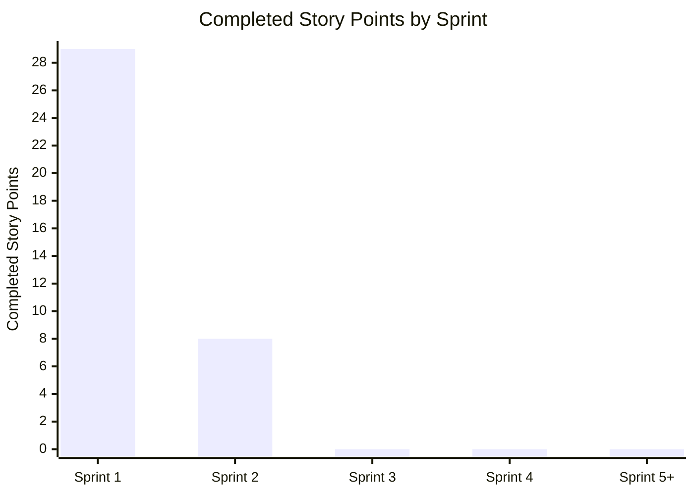

# Tropos Delivery & DORA Metrics

> Generated automatically from GitHub repository data. Do not edit manually.
> Last generated: 2026-10-12 09:22 UTC

## Sprint delivery

| Sprint | Planned SP | Completed SP | Remaining SP |
|---|---:|---:|---:|
| Sprint 1 | 29 | 29 | 0 |
| Sprint 2 | 36 | 8 | 28 |
| Sprint 3 | 42 | 0 | 42 |
| Sprint 4 | 31 | 0 | 31 |
| Sprint 5+ | 42 | 0 | 42 |

### Current sprint burndown — Sprint 1

_Actual burndown will render automatically after sprint start/end dates are configured._

### Velocity

Velocity is accepted story points completed in each sprint. It is a team forecasting metric, not an individual productivity metric.

## Engineering flow

| Metric | Current value | Definition |
|---|---:|---|
| Median PR cycle time | 0.1 h | PR opened to merged |
| Open current-sprint stories | 0 | Current-sprint issues not yet closed |
| Current-sprint remaining work | 0 SP | Unaccepted story points |

## DORA metrics

| DORA metric | Current value | Measurement source |
|---|---:|---|
| Deployment frequency | 0 production deployments / 30 days | GitHub Deployments for configured production environments |
| Lead time for changes | N/A | Commit timestamp to production deployment timestamp |
| Change failure rate | N/A | Requires an explicit production change-failure or rollback signal linked to a deployment |
| Mean time to restore | N/A | Requires incident start and service-restored timestamps |

DORA values are reported only when the repository contains the required production signals. Failed CI jobs or failed deployment attempts are not treated as production change failures.

## Data quality

- Sprint dates in docs/product/delivery-metrics-config.json are required for a time-based burndown.
- Story points are read from issue bodies using the Estimate: N SP field.
- Closed issues count as completed only when the team has accepted them under the Definition of Done.
- Change failure rate and mean time to restore remain N/A until production incident conventions are implemented.
